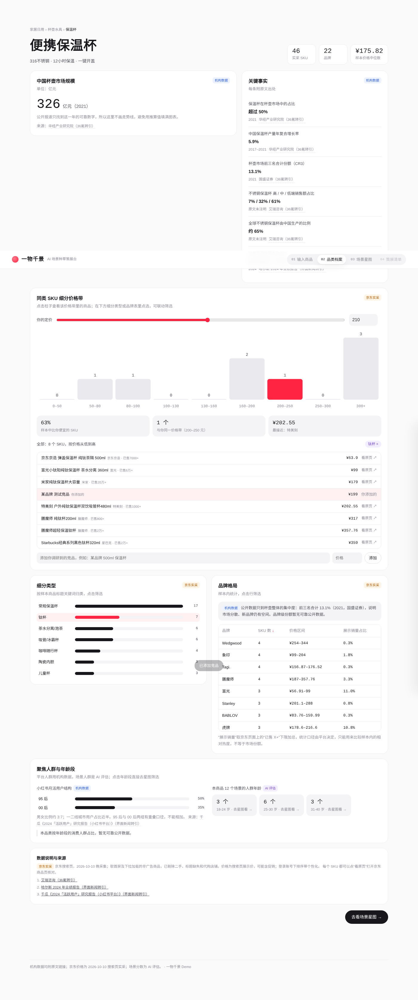
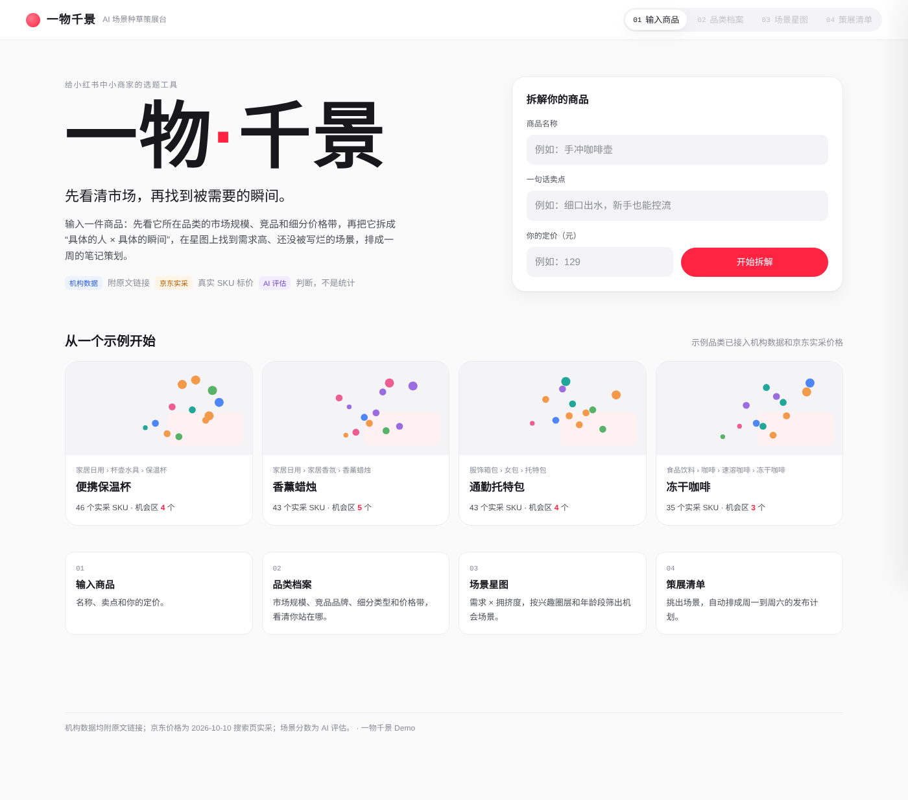
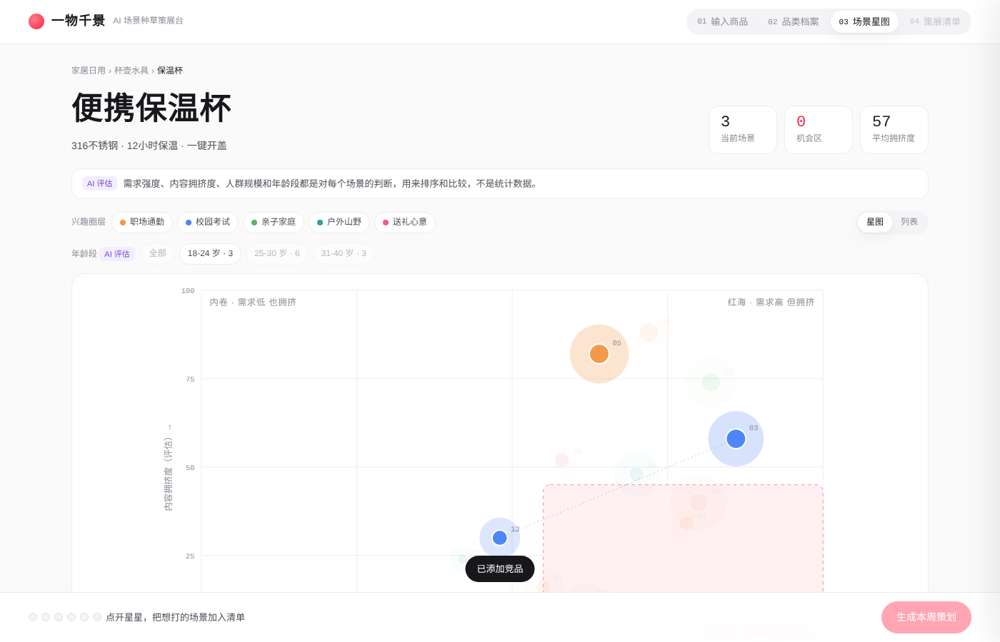
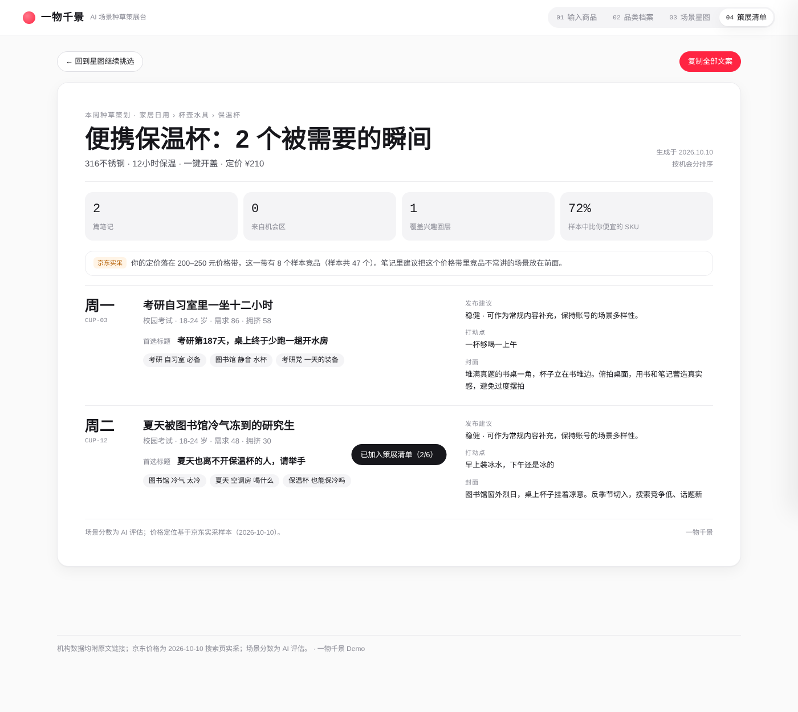

# 一物千景 · AI 场景种草策展台

> 先看清市场，再找到被需要的瞬间。

给小红书中小商家的选题工具：输入一件商品，先看它所在品类的市场规模、竞品品牌和细分价格带，再把它拆成「具体的人 × 具体的瞬间」，在星图上找到**需求高、还没被写烂**的场景，排成一周的笔记策划。

**在线体验：** `https://doloreschw.github.io/-/`（开启 GitHub Pages 后可用，见下文）
**REDcowork 作品链接：** _待补充_



---

## 面向谁，解决什么问题

面向在小红书上经营的中小商家、主理人和新品牌运营。他们请不起咨询公司做用户研究，也拿不到官方洞察工具的权限。

平台正在淘汰“批量同质化铺笔记”的打法，转向“以人为本、打透细分场景”。但商家大多用品类词思考（“保温杯推荐”），用户却用场景说话（“凌晨赶稿的时候想喝口热的”）。商家既不清楚自己在价格带里站在哪，也不知道商品还会被哪些人、在哪些瞬间需要。

## 四步流程

| 步骤 | 页面 | 可以做什么 |
| --- | --- | --- |
| 01 | 输入商品 | 填商品名、卖点和你的定价，或选择 4 个示例品类之一 |
| 02 | 品类档案 | 看市场规模和关键事实（附出处）；拖动“你的定价”看分位和同价格带竞品；点细分类型、品牌或价格柱联动筛选 SKU；添加自己调研到的竞品价格 |
| 03 | 场景星图 | 12 个场景排在「需求 × 拥挤度」坐标上，可按兴趣圈层和年龄段筛选，点开看痛点、搜索词、标题和封面构图 |
| 04 | 策展清单 | 挑最多 6 个场景，自动排成周一到周六的计划，附价格定位说明，一键复制 |

| 首页 | 场景星图 | 一周策划 |
| --- | --- | --- |
|  |  |  |

## 数据从哪来（请务必阅读）

页面上每一块数据都用颜色标明了来源，三类数据分开处理：

| 标签 | 含义 | 内容 |
| --- | --- | --- |
| 机构数据 | 研究机构或公司公开披露，**每条附原文链接** | 市场规模、增速、集中度、高中低端占比、小红书用户结构等 |
| 京东实采 | 2026-10-10 晚在京东搜索页实际采集 | 4 个品类共 167 个 SKU 的标题、展示价、展示销量、店铺，每个都能点开原商品页核对 |
| AI 评估 | 对每个场景的判断，**不是统计数据** | 需求强度、内容拥挤度、人群规模、场景对应年龄段 |

**有意留空的地方：** 找不到可靠公开来源的数字一律不填，页面上直接写“暂无可靠公开数据”。包括：品牌级市场份额、按年龄段划分的品类消费人群占比、托特包和冻干咖啡单独的市场规模、保温杯和香薰只有一年数据（因此不画走势，不用推算值填图）。

**京东采集口径：** 取搜索结果首屏及下拉加载的非广告商品，剔除二手、标题缺失和代购店铺；价格为搜索页展示价，可能含促销；采集时账号已登录，排序带个性化。“展示销量”取页面“已售 X+”的下限，只能比较样本内的相对热度，不等于市场份额。原始记录见 `data/jd_raw.py`。

**机构数据来源：**

1. [36氪：保温杯行业文章](https://www.36kr.com/p/2818084401220100)（转引华经产业研究院、国盛证券、艾瑞咨询）
2. [界面新闻：保温杯出口与哈尔斯业绩](https://www.jiemian.com/article/12928497.html)
3. [智研咨询：2025 年中国家居香氛行业分析](https://www.chyxx.com/industry/1206814.html)
4. [艾媒咨询：速溶咖啡报告标签页](https://report.iimedia.cn/tag/%E9%80%9F%E6%BA%B6%E5%92%96%E5%95%A1)
5. [观研天下：速溶咖啡行业报告](https://www.chinabaogao.com/baogao/202305/635620.html)
6. [界面新闻：精品速溶咖啡](https://www.jiemian.com/article/7352386.html)（转引第一财经 YiMagazine 估算）
7. [观研天下：女包行业分析](https://www.chinabaogao.com/free/202310/667695.html)
8. [界面新闻：小红书买手电商](https://www.jiemian.com/article/11499491.html)（转引千瓜《2024「活跃用户」研究报告》）

## 本地运行与修改

纯前端，无需安装依赖，直接用浏览器打开根目录的 `index.html`。

```bash
python3 data/build_market.py   # 改了 data/ 里的采集记录或机构数据后，重新生成 src/market.js
python3 build.py               # 把 src/ 合并成根目录的单文件 index.html
```

## 项目结构

```
├── index.html              # 单文件构建产物（GitHub Pages / REDcowork 用这个）
├── build.py                # 把 src/ 合并成单文件
├── data/
│   ├── jd_raw.py           # 京东实采原始记录
│   └── build_market.py     # 机构数据 + 采集记录 → src/market.js
├── src/
│   ├── index.html          # 页面结构
│   ├── styles.css          # 样式与设计 token
│   ├── data.js             # 示例商品的 48 个场景 + 自定义生成用的场景库
│   ├── market.js           # 品类市场数据（生成文件）
│   └── app.js              # 交互逻辑
└── docs/screenshots/
```

## 开启 GitHub Pages

仓库 Settings → Pages → Build and deployment，Source 选 **Deploy from a branch**，Branch 选 `main`、目录 `/ (root)`，保存后约 1 分钟即可访问。

## 后续可以做的

- 接入平台搜索词和笔记数据，把场景的“评估分”换成真实指标
- 定期重新采集价格，展示价格带随时间的变化
- 接入大模型，让任意商品都能生成精修级别的场景
- 跟踪已发布笔记的表现，回写到星图，形成“策划 → 发布 → 复盘”的闭环

---

为小红书大商业校招 AI Builder Test 制作
