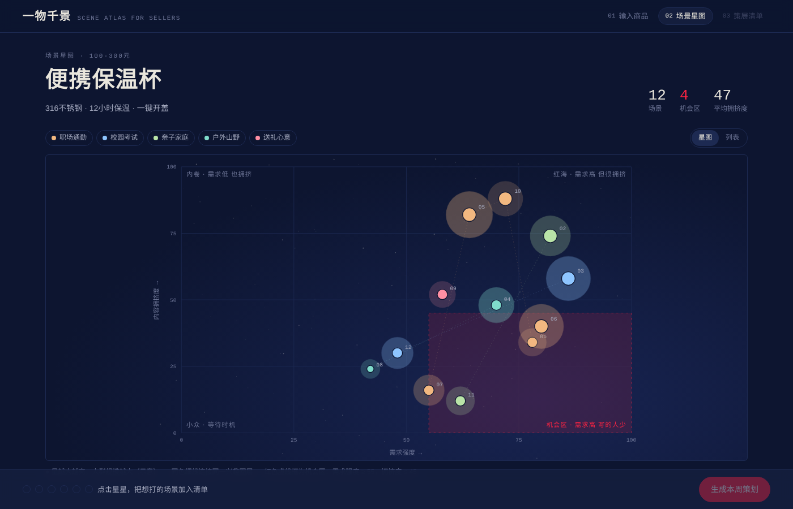
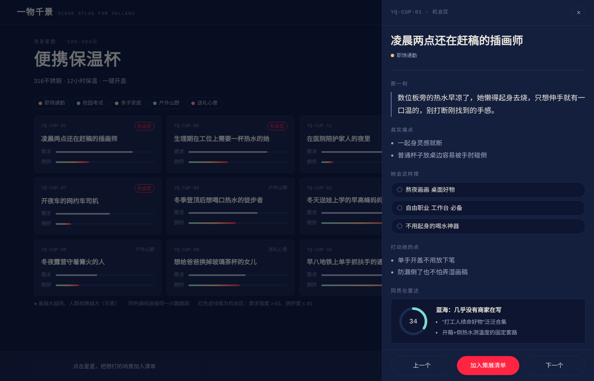
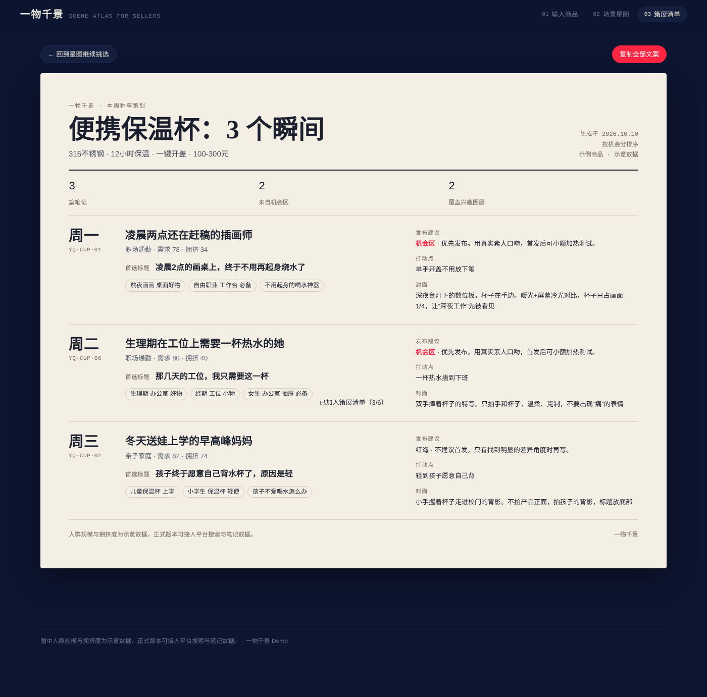

# 一物千景 · AI 场景种草策展台

> 一件货，一千个被需要的瞬间。

把一件商品拆成「具体的人 × 具体的瞬间」，在一张星图上找到**需求高、还没被写烂**的种草场景，再排成一周的笔记策划。

**在线体验：** `https://doloreschw.github.io/-/`（开启 GitHub Pages 后可用，见下文）
**REDcowork 作品链接：** _待补充_



---

## 面向谁

在小红书上经营的中小商家、主理人和新品牌运营。他们没有预算请咨询公司做用户研究，也拿不到官方洞察工具（如灵犀）的权限。

## 解决什么问题

平台正在淘汰“批量同质化铺笔记”的打法，转向“以人为本、打透细分场景”。但商家大多用品类词思考（“保温杯推荐”），用户却用场景说话（“凌晨赶稿的时候想喝口热的”）。商家不知道自己的商品还会被哪些人、在哪些瞬间需要，只好继续写千篇一律的笔记。

「一物千景」把咨询公司拆解消费场景的方法，变成一个人人可用的小工具。

## 怎么用

| 步骤 | 页面 | 做什么 |
| --- | --- | --- |
| 01 | 输入商品 | 填写商品名、一句话卖点和价格区间，或者直接选择 4 个示例商品之一 |
| 02 | 场景星图 | 12 个场景排布在「需求强度 × 内容拥挤度」坐标上。右下角红框是机会区；星越亮，人群越大；同色虚线连接同一兴趣圈层 |
| 02 | 场景详情 | 点开任意星星：那一刻的画面、真实痛点、用户会怎么搜、打动点、同质化雷达、3 个标题建议、3:4 封面构图示意 |
| 03 | 策展清单 | 挑最多 6 个场景，按机会分自动排成周一到周六的发布计划，可一键复制全部文案 |

| 首页 | 场景详情 | 一周策划 |
| --- | --- | --- |
|  |  |  |

## 设计思路

- **星图隐喻。** 每件商品是一个星座，每个场景是一颗编了星表号的星（如 `YQ·CUP·07`）。人群规模用“星等”表示，1 等星最亮、人群最大。
- **两个维度做决策。** 横轴需求强度，纵轴内容拥挤度。机会区定义为需求强度 ≥ 55 且拥挤度 ≤ 45，机会分 = 需求 × 0.6 + (100 − 拥挤) × 0.4。
- **策划结果是一张纸。** 星图是深色夜空，最终的周策划是一张浅色“星表纸页”，方便截图分享给团队。
- **小红书红只用在两个地方：** 机会区和主按钮。

## 关于数据（请务必阅读）

- 4 个示例商品（便携保温杯、香薰蜡烛、通勤托特包、冻干咖啡）共 48 个场景，内容为人工撰写，**人群规模与拥挤度均为示意数据**，不是平台真实数据。
- 输入其他商品时，工具会用内置的「人群 × 瞬间 × 痛点」场景库组合生成结果，同一商品名每次结果一致。它是策划起点，不是成品。
- 正式落地时，可以接入平台的搜索词与笔记数据，替换为真实的需求和拥挤度指标；也可以接入大模型，替换组合生成部分。

## 本地运行

纯前端，无需安装任何依赖。

```bash
# 直接用浏览器打开根目录下的 index.html 即可
# 修改 src/ 里的文件后，重新生成单文件版本：
python3 build.py
```

## 项目结构

```
├── index.html          # 单文件构建产物（GitHub Pages / REDcowork 用这个）
├── build.py            # 把 src/ 合并成单文件 index.html
├── src/
│   ├── index.html      # 页面结构
│   ├── styles.css      # 样式与设计 token
│   ├── data.js         # 示例商品场景数据 + 自定义生成用的场景库
│   └── app.js          # 交互逻辑：星图、抽屉、策划生成
└── docs/screenshots/   # 截图
```

## 开启 GitHub Pages

仓库 Settings → Pages → Build and deployment，Source 选 **Deploy from a branch**，Branch 选 `main`、目录 `/ (root)`，保存后约 1 分钟即可通过上面的链接访问。

## 后续可以做的

- 接入真实搜索词与笔记数据，替换示意指标
- 接入大模型，让任意商品都能生成精修级别的场景
- 跟踪已发布笔记的表现，回写到星图上，形成“策划 → 发布 → 复盘”的闭环

---

为小红书大商业校招 AI Builder Test 制作
